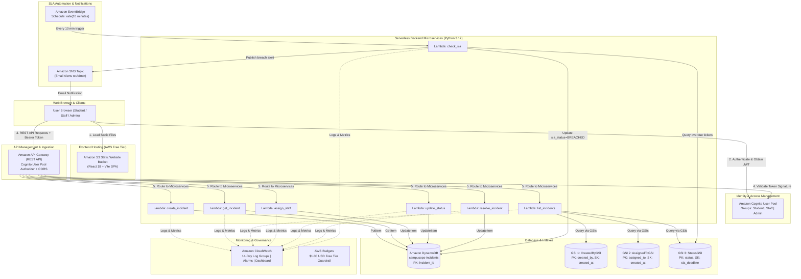

# 🛡️ CampusOps: Cloud-Native University Incident Management Platform

> **Final-Year Engineering Project** • Built with AWS Serverless Architecture & DevOps Automation • Target Region: `ap-south-1` (Mumbai) • **100% AWS Free Tier Compliant**

---

## 1. Project Overview

**CampusOps** is a centralized, cloud-native maintenance management platform designed to replace informal communication channels (WhatsApp, phone calls, paper slips) in universities and colleges.

### 🌐 Live Cloud Deployment Endpoints (`ap-south-1` Mumbai)

| Component | Endpoint / Identifier | Description |
| :--- | :--- | :--- |
| **Frontend Web App** | [http://campusops-frontend-dev-c0cf6c4c.s3-website.ap-south-1.amazonaws.com](http://campusops-frontend-dev-c0cf6c4c.s3-website.ap-south-1.amazonaws.com) | Live S3 static website hosting React 18 SPA. |
| **REST API Gateway** | `https://lp0jvwl5f9.execute-api.ap-south-1.amazonaws.com/dev` | Cognito-authorized HTTPS API stage. |
| **Cognito User Pool** | `ap-south-1_UmR09agC8` | University user authentication pool. |
| **Cognito App Client** | `3037at1btmphctj8j46a85gg79` | Public web client for user login. |
| **DynamoDB Table** | `campusops-incidents-dev` | Single-table incident store with 3 GSIs. |
| **CloudWatch Dashboard** | `campusops-dashboard-dev` | Real-time monitoring metrics dashboard. |
| **SNS Alert Topic** | `arn:aws:sns:ap-south-1:418059030221:campusops-sla-alerts-dev` | Escalation alert topic for breached SLAs. |

It empowers:
- **Students**: To report campus issues (electrical, plumbing, Wi-Fi, lab equipment, classroom furniture) with priority levels and track real-time resolution deadlines.
- **Maintenance Technicians**: To view assigned work orders, update progress to `IN_PROGRESS`, and log mandatory resolution notes.
- **Campus Administrators**: To manage all departmental issues, allocate technicians, monitor SLA compliance, and receive instant alerts when deadlines breach.

---

## 2. Serverless System Architecture



---

## 3. Technology Stack & AWS Resource Summary

| Layer | Technology / Service | What It Does (In One Line) |
| :--- | :--- | :--- |
| **Frontend** | React 18 + Vite | Fast, responsive single-page application with role-based dashboards for Students, Staff, and Admins. |
| **Hosting** | Amazon S3 | Static website hosting bucket serving HTML, CSS, and JavaScript with zero idle server cost. |
| **Auth** | Amazon Cognito | Manages user registration, JWT issuance, and RBAC user groups (`Student`, `Staff`, `Admin`). |
| **API** | Amazon API Gateway | Secure HTTPS REST gateway validating Cognito JWTs and routing traffic to backend microservices. |
| **Compute** | AWS Lambda (Python 3.12) | Serverless execution of business logic on demand (128 MB RAM, 10s timeout, 100% Free Tier). |
| **Database** | Amazon DynamoDB | NoSQL key-value database with On-Demand capacity and 3 GSIs for single-digit millisecond queries. |
| **Automation** | Amazon EventBridge | Serverless cron scheduler triggering the SLA monitor Lambda every 10 minutes. |
| **Alerts** | Amazon SNS | Pub/Sub messaging service dispatching automated email notifications when tickets breach SLAs. |
| **Monitoring** | Amazon CloudWatch | Centralized log storage (14-day retention cap), metric alarms, and operations dashboard. |
| **Cost Guard** | AWS Budgets | Sets an immediate email alert if monthly cloud expenditure is forecasted to exceed \$1.00. |
| **IaC** | Terraform | Infrastructure as Code defining 85 AWS resources in clean, repeatable HCL modules. |
| **CI/CD** | GitHub Actions | Automated linting, testing, SonarCloud security scanning, and gated deployment pipelines. |

---

## 4. Priority-Based SLA Response Windows

| Priority | Resolution Target | Formula | Action When Breached |
| :--- | :---: | :--- | :--- |
| **CRITICAL** | **1 Hour** | `created_at + 1h` | EventBridge triggers Lambda → Status marked `BREACHED` → Urgent SNS email sent to Admin. |
| **HIGH** | **4 Hours** | `created_at + 4h` | Status marked `BREACHED` → SNS escalation dispatched to Facilities Head. |
| **MEDIUM** | **12 Hours** | `created_at + 12h` | Status marked `BREACHED` → SNS summary alert sent. |
| **LOW** | **24 Hours** | `created_at + 24h` | Status marked `BREACHED` → Logged on Admin dashboard. |

---

## 5. Quick Start: Local Development & Testing

### Prerequisites
- Python 3.10 or 3.12
- Node.js 18+ and npm

### 1. Run Backend Unit Tests (32 tests via Moto AWS Mocks)
```powershell
# From project root
pip install -r backend/requirements.txt
python -m pytest backend/tests -v
```
*(All 32 tests run in-memory; no real AWS connection or cloud bill is touched).*

### 2. Run Frontend Web Application
```powershell
cd frontend
npm install
npm run dev
```
Open **`http://localhost:5173`** in your browser.
- Use the quick demo buttons on the top navbar (`Student`, `Staff`, `Admin`) to toggle between personas instantly.
- Report tickets, view live SLA countdowns, assign technicians, and mark issues resolved with notes.

### 3. Run Frontend Unit Tests
```powershell
cd frontend
npm test
```

---

## 6. AWS Deployment Guide (Terraform Infrastructure as Code)

> [!IMPORTANT]
> To comply with project guidelines, **`terraform apply` is executed manually by you** using your personal AWS account credentials.

### Step 1: Configure AWS CLI
```powershell
aws configure
# Enter AWS Access Key ID, Secret Access Key, and region: ap-south-1
```

### Step 2: Validate and Plan Infrastructure
```powershell
cd infra/terraform
terraform init
terraform validate
terraform plan
```

### Step 3: Apply Infrastructure
```powershell
terraform apply
# Type 'yes' to provision the 85 AWS resources
```

### Step 4: Deploy Frontend to S3 Static Website Bucket
After `terraform apply` finishes, copy the output bucket name and run:
```powershell
cd ../../frontend
npm run build
aws s3 sync dist/ s3://<s3_frontend_bucket_name>/ --delete
```
Open the `s3_website_endpoint` URL in your browser to access your live cloud-hosted application!

---

## 7. Project File Structure

```text
campusops-dev/
├── .github/
│   └── workflows/
│       ├── ci.yml                 # Test, lint, SonarCloud, and Terraform plan on PRs
│       └── cd.yml                 # Terraform apply & S3 deploy with manual approval gate
├── backend/
│   ├── src/
│   │   ├── lambdas/               # 7 Serverless Microservices (Python 3.12)
│   │   │   ├── create_incident.py
│   │   │   ├── get_incident.py
│   │   │   ├── list_incidents.py
│   │   │   ├── assign_staff.py
│   │   │   ├── update_status.py
│   │   │   ├── resolve_incident.py
│   │   │   └── check_sla.py
│   │   └── shared/                # Shared DB, Auth, and CORS Response helpers
│   ├── tests/                     # 32 pytest unit tests with Moto AWS mocks
│   └── requirements.txt
├── frontend/
│   ├── src/
│   │   ├── components/            # Navbar, StatusBadge, SLAIndicator, CreateModal
│   │   ├── views/                 # StudentView, StaffView, AdminView, LoginView
│   │   ├── services/              # api.js and auth.js
│   │   ├── App.jsx
│   │   └── styles.css             # Responsive mobile-first CSS design
│   ├── package.json
│   └── vite.config.js
├── infra/
│   └── terraform/                 # 85 AWS Resources Defined as Code
│       ├── main.tf, variables.tf, outputs.tf
│       ├── dynamodb.tf            # Table with 3 GSIs (On-Demand)
│       ├── cognito.tf             # User Pool, Client, and Groups
│       ├── iam.tf                 # Least-privilege IAM roles and policies
│       ├── lambda.tf              # Lambda functions with archive_file packaging
│       ├── apigateway.tf          # REST API, Cognito Authorizer, and CORS
│       ├── s3.tf                  # Static website hosting bucket
│       ├── eventbridge.tf         # 10-minute scheduled SLA check rule
│       ├── sns.tf                 # Topic & email subscription for admin alerts
│       ├── cloudwatch.tf          # 14-day capped log groups, alarms, dashboard
│       └── budget.tf              # $1.00 USD Free Tier budget alert
├── monitoring/                    # Optional local Prometheus & Grafana stack
│   ├── docker-compose.yml
│   └── prometheus/prometheus.yml
├── docs/
│   ├── project.md                 # Project requirements specification
│   ├── PROGRESS.md                # Development phase log and milestone tracker
│   └── VIVA_NOTES.md              # Question-and-answer viva defense preparation guide
└── AGENTS.md                      # Engineering guidelines and rules
```

---

## 8. AWS Free Tier Cost Protection Guarantee

1. **No Idle Server Charges**: Uses 100% serverless services (API Gateway + Lambda + DynamoDB + S3). When zero students are using the app, cost is **\$0.00**.
2. **DynamoDB On-Demand**: Pay-per-request mode with 25 RCU/WCU free forever.
3. **Lambda Execution**: 128 MB RAM and 10s timeout capped; first 1,000,000 monthly requests are completely free.
4. **Log Retention Capped**: CloudWatch Log Groups are capped at **14 days**, avoiding perpetual storage accumulation charges.
5. **Local Prometheus/Grafana**: Monitoring tools run locally in Docker Compose rather than on costly AWS EC2 virtual machines.
6. **AWS Budget**: Active \$1.00 limit with email alerts triggered at 80% and 100%.

